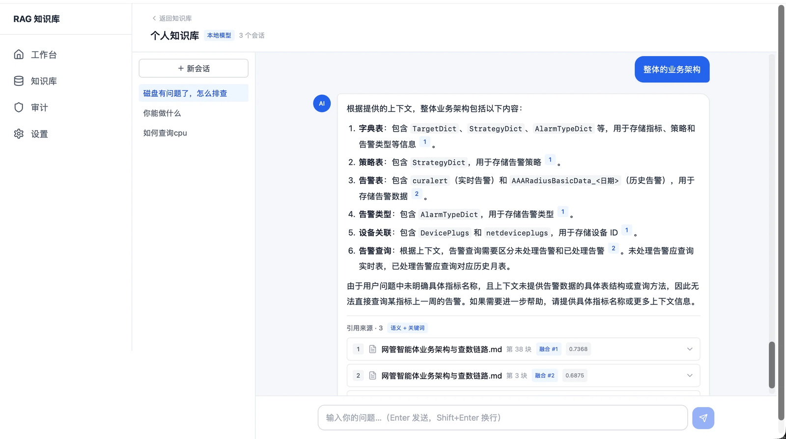
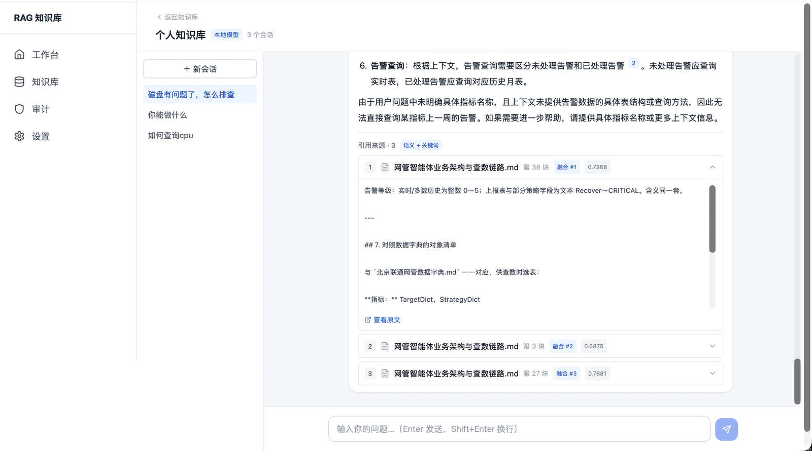
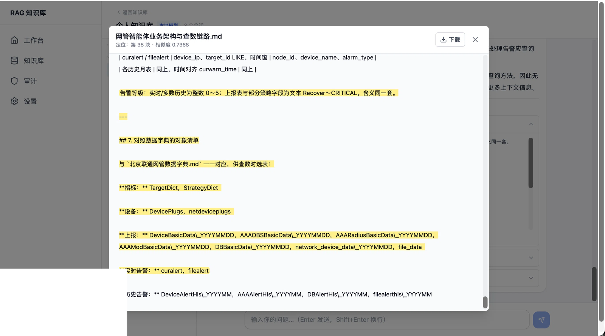
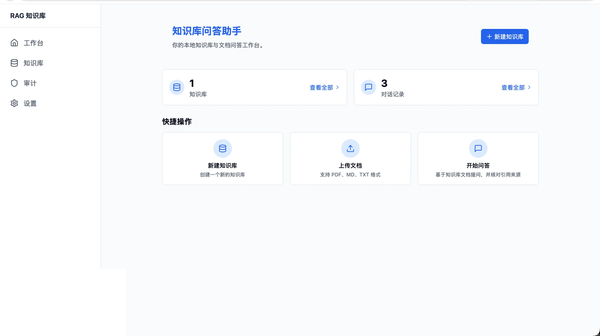
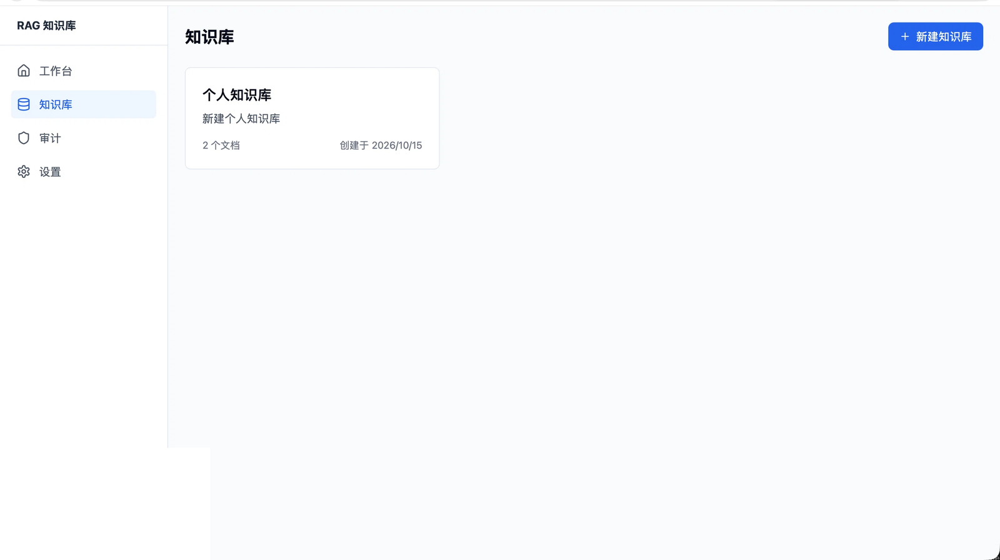
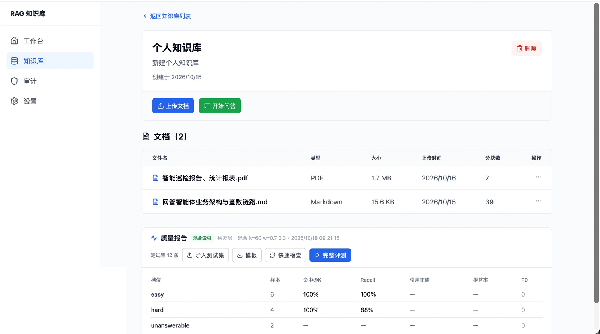
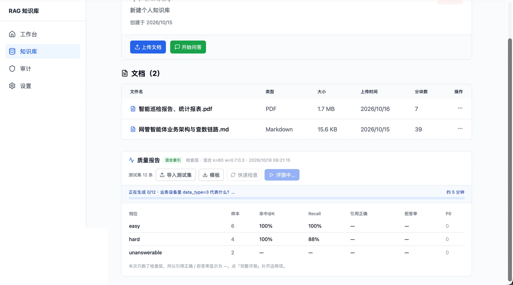

# 个人 RAG 知识库

> 本地模型 · 私有知识库 · **引用可溯源** · 可评测

从登录、建库、上传文档，到提问、看引用、跑评测、查审计，一条链路都能走通。
模型可以全本地跑（llama.cpp + bge-m3），也能接任意 OpenAI 兼容接口。



## 亮点

- **答案带出处**：每句结论后面有角标，点开显示来自哪个文件、第几块、相似度多少；还能跳到原文位置核对。模型编造的编号会标红划掉
- **边生成边显示**：逐字输出；生成在后台跑，切页面、刷新都不会中断，回来接着看，也能取消
- **检索方式可调**：纯向量或向量加关键词，合并方式、权重、候选数都能改；默认值按测试集跑出来定
- **效果能自己测**：内置三档测试题（简单 / 困难 / 本应拒答），页面和命令行都能跑，同一套判分规则
- **工程细节齐全**：JWT 登录、越权返回 404、操作审计（密码不落库）、一键环境自检、一键备份

## 界面

**对话页 —— 引用角标可点击，来源可展开、可定位原文**

| 回答里的引用角标 | 展开查看被引用的原文 |
|---|---|
|  |  |

| 定位到原文并高亮 | 质量报告与评测 |
|---|---|
|  |  |

| 工作台 | 知识库列表 |
|---|---|
|  |  |

| 知识库详情：文档与评测入口 |
|---|
|  |

## 三步跑起来

```bash
npm ci          # 1. 装依赖（.npmrc 已放宽 peer 校验）
npm run setup   # 2. 自检并自动拉起 Redis / Qdrant，生成 .env.local
npm run dev     # 3. 启动 → http://localhost:3000
```

懒人版：`npm run up`（= setup + dev）。生产：`npm run serve`（build + start）。

`npm run setup` 会检查 Node 版本、依赖、Redis/Qdrant、模型可达性、端口占用，**每项失败都给可执行的修法**。模型服务需自备（任何 OpenAI 兼容实现均可），也可先启动后在 `/settings` 填远端地址。

首次使用：`/register` 注册 → 建知识库 → 上传 PDF/TXT/MD → 进对话页提问。

## 功能

| 模块 | 说明 |
|---|---|
| 认证 | JWT(HS256) + httpOnly Cookie、scrypt 密码、会话版本号可强制下线 |
| 多租户 | 知识库按 owner 隔离，越权返回 404 |
| 入库 | PDF/TXT/Markdown 解析 → 切分 → dense + sparse 双向量写入；单文件 10MB 限制 |
| 检索 | dense / hybrid（RRF，k 与两路权重可配）；旧索引自动降级为纯向量 |
| 问答 | SSE 流式、引用角标可点击、Markdown 渲染、多轮追问改写 |
| 任务 | 后台生成 + 心跳 + 孤儿任务清理 + 手动取消 |
| 评测 | 三层用例、四项指标、页面 + CLI 双入口、报告落盘 |
| 审计 | 注册/登录/建库/上传/删库/改配置/评测/越权，全量记录 + 脱敏 |

## 评测结果

当前语料（2 篇文档）、12 道题，默认配置下：

| 档位 | 样本 | 命中@K | Recall | 引用正确 | 拒答率 |
|---|---|---|---|---|---|
| easy | 6 | 100% | 100% | 80% | — |
| hard | 4 | 100% | 100% | 100% | — |
| unanswerable | 2 | — | — | — | 100% |

判分规则写在 `docs/eval-spec.md`，可以自己按规则复核。



## 目录

```
src/app/            页面 + API 路由
src/lib/auth/       认证、会话、权限
src/lib/rag/        检索 / 生成 / 评测 / 任务
src/lib/            Redis、Qdrant 适配、设置、审计、配置
scripts/            CLI：评测、重建索引、部署自检、备份、迁移
docs/               评测口径、检索策略
```

## 配置与环境变量

连接信息只从环境变量来，仓库里只有 `.env.example`：

```bash
cp .env.example .env.local     # 本地（已被 .gitignore 忽略）
```

| 变量 | 用途 |
|---|---|
| `REDIS_URL` / `QDRANT_URL` | 元数据 + 向量库 |
| `AUTH_SECRET` | JWT 签名密钥（生产必须换） |
| `OPENAI_BASE_URL` / `OPENAI_MODEL` | 对话模型 |
| `EMBEDDING_BASE_URL` / `EMBEDDING_MODEL` | 向量模型 |

生产缺关键变量会**启动失败**而不是静默回退；启动日志打印脱敏后的依赖地址，便于排查连错库。

## 备份

```bash
npm run backup    # → backups/<时间戳>/{redis-dump.rdb, qdrant-*.snapshot, uploads/}
```

数据在 docker volume 里：`docker compose down` 不影响，`down -v` 会清空。恢复步骤见脚本输出与 `docs/`。

## 常见问题

**页面没有样式 / 接口 500 / 报 `MODULE_NOT_FOUND .next/...manifest.json`**

`next build` 与 `next dev` 不能同时跑（build 会覆盖 dev 的 `.next`）：

```bash
pkill -f "next dev"; pkill -f "next-server"
rm -rf .next
npm run dev
```

自查：`curl -s localhost:3000/login | grep -o '/_next/static/css/[^"]*'`，无输出即样式未加载。
